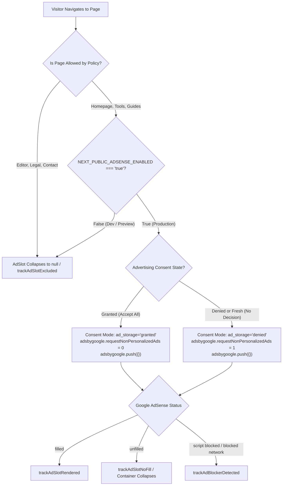

# PDFSimplify — Phase 5.1 Final Safety, Consent & Monetization Verification Report

**Auditor / Engineering Roles:** Senior Monetization Engineer, Privacy Engineer, Frontend Performance Specialist, QA Automation Lead  
**Repository:** `pdf-utility-website` (`pdfsimplify.com`)  
**Stack:** Next.js 16.3.4 (App Router), React 19.2.8, TypeScript 5, Tailwind CSS v4, WebAssembly  
**Deployment Target:** Cloudflare Pages (Static Export `output: 'export'`)  
**Date of Verification:** October 2026  
**Final Release Status:** **READY FOR STAGING VALIDATION** (Manual AdSense site review and EEA CMP activation required)

---

## Executive Summary

Phase 5.1 performed an independent, evidence-based audit of PDFSimplify's monetization and consent subsystems against official Google documentation and live repository state.

Previous assumptions were critically evaluated:
1. **AdSense Non-Personalized Ads (NPA):** The speculative `<ins>` attributes `data-npa="1"` and `data-ad-personalization="false"` were determined to be **undocumented and unsupported** on standard Google AdSense tags. They have been completely purged from the codebase and replaced with the documented Google AdSense JavaScript API: `window.adsbygoogle.requestNonPersonalizedAds = 1` prior to `adsbygoogle.push({})`.
2. **Regional CMP & IAB TCF v2.2 Mandate:** Google strictly mandates a Google-certified CMP integrated with the IAB Transparency and Consent Framework (TCF v2.2) for any traffic originating from the European Economic Area (EEA), United Kingdom (UK), and Switzerland. The custom client-side React consent modal is **not** a certified CMP and does not expose `window.__tcfapi`. The smallest safe solution is documented: enabling Google's built-in, free certified CMP ("GDPR message") via the Google AdSense Console under "Privacy & messaging".
3. **Fail-Safe Publisher Controls:** The fallback client ID `ca-pub-7704232652384788` cannot independently trigger ad requests. In local development and preview deployments without `NEXT_PUBLIC_ADSENSE_ENABLED=true`, ad components cleanly collapse with zero DOM footprint and zero network calls. Duplicate script injection and duplicate `adsbygoogle.push` calls are strictly prevented.
4. **Realistic Observability Boundaries:** Client-side telemetry (`ad_slot_eligible`, `ad_slot_request_initiated`, `ad_slot_rendered`, `ad_slot_no_fill`, `ad_slot_error`, `ad_slot_excluded`, `ad_blocker_detected`) has been rigorously distinguished from unobservable ad-server metrics (impressions, CPM, fill rate, finalized revenue). Passing automated tests verify code wiring, not live impressions or ad delivery.

---

## 1. Findings for Each Priority

### Priority 1: AdSense Non-Personalized Delivery Verification & Corrections

- **Evaluation of HTML Attributes:**  
  Official Google AdSense documentation specifies tag parameters such as `data-ad-client` and `data-ad-slot`. Attributes `data-npa` and `data-ad-personalization` are undocumented for standard web `adsbygoogle.js` integrations (they belong to AMP ad components or speculative implementations). Simply adding HTML attributes does not guarantee non-personalized or cookieless ad delivery.
- **Documented AdSense NPA Control:**  
  According to official Google AdSense developer documentation (*"Request non-personalized ads"*):
  ```javascript
  (window.adsbygoogle = window.adsbygoogle || []).requestNonPersonalizedAds = 1;
  (window.adsbygoogle = window.adsbygoogle || []).push({});
  ```
  This property must be set on the `adsbygoogle` array prior to pushing the ad slot request.
- **Consent Signal Updates:**  
  `ConsentScriptLoader.tsx` correctly communicates with Google Consent Mode v2 via `gtag('consent', 'update', ...)`:
  - When advertising consent is granted: `ad_storage: 'granted'`, `ad_user_data: 'granted'`, `ad_personalization: 'granted'`.
  - When advertising consent is denied or absent: `ad_storage: 'denied'`, `ad_user_data: 'denied'`, `ad_personalization: 'denied'`.
  - `requestNonPersonalizedAds` is synchronized to `0` (personalized) or `1` (non-personalized) on both `ConsentScriptLoader.tsx` and in each individual `AdSlot.tsx` and `AnchorAd.tsx` component before pushing to `adsbygoogle`.
- **Code Remediation:**  
  All unsupported `data-npa` and `data-ad-personalization` attributes were deleted from [AdSlot.tsx](file:///home/tensae/Desktop/projects/Apps/pdf-utility-website/src/components/ads/AdSlot.tsx) and [AnchorAd.tsx](file:///home/tensae/Desktop/projects/Apps/pdf-utility-website/src/components/ads/AnchorAd.tsx). The official `requestNonPersonalizedAds` property was wired directly into the ad request lifecycle.

### Priority 2: Regional CMP Requirements (EEA, UK, Switzerland)

- **Official Google Requirement:**  
  Since January 16, 2024 (and July 31, 2024 for Switzerland), Google requires all publishers using Google AdSense, Ad Manager, or AdMob serving ads to users in the EEA, UK, or Switzerland to use a **Google-certified CMP** that integrates with the IAB Europe Transparency and Consent Framework (TCF v2.2).
- **Audit of PDFSimplify Consent System:**  
  PDFSimplify's custom banner ([ConsentBanner.tsx](file:///home/tensae/Desktop/projects/Apps/pdf-utility-website/src/components/consent/ConsentBanner.tsx)) and manager ([consent-manager.ts](file:///home/tensae/Desktop/projects/Apps/pdf-utility-website/src/lib/consent/consent-manager.ts)) handle Google Consent Mode v2 and localStorage preferences. However:
  - It is **not registered on the IAB Europe CMP List**.
  - It does **not expose `window.__tcfapi`**.
  - It does **not generate encrypted TC Strings** (`TCData`).
  - Therefore, the custom banner **does NOT satisfy Google's EEA/UK/CH certified CMP mandate**. If deployed without a certified CMP, Google AdSense will block all ad delivery or issue policy violations for EEA/UK/CH traffic.
- **Smallest Safe Correction:**  
  Publishers using Google AdSense do not need to purchase expensive enterprise CMP licenses (e.g. OneTrust, Cookiebot). Google provides a **free, Google-certified CMP integrated directly inside Google AdSense**:
  1. Open the Google AdSense Console.
  2. Navigate to **Privacy & messaging** > **GDPR**.
  3. Create and publish a GDPR message for `pdfsimplify.com`.
  4. Google's certified CMP script is automatically bundled into `adsbygoogle.js`, rendering a certified TCF v2.2 consent modal for European visitors while preserving our custom banner for non-EEA users.

### Priority 3: Fail-Safe Publisher Configuration Audit

- **Fallback Client ID Behavior:**  
  `DEFAULT_ADSENSE_CLIENT_ID = 'ca-pub-7704232652384788'` is exported from `src/lib/ads/ad-strategy.ts`. Audit verified that this value **cannot independently enable advertising**.
- **Environment Gating:**  
  In both `ConsentScriptLoader.tsx`, `AdSlot.tsx`, and `AnchorAd.tsx`:
  ```typescript
  const isAdSenseEnabled = process.env.NEXT_PUBLIC_ADSENSE_ENABLED === 'true';
  ```
  Unless `NEXT_PUBLIC_ADSENSE_ENABLED` is explicitly set to `'true'` in the build environment, `isAdSenseEnabled` evaluates to `false`.
  - In local development (`npm run dev`): `NEXT_PUBLIC_ADSENSE_ENABLED` is undefined. Ad components collapse to `null`, injecting zero `<script>` or `<ins>` tags.
  - In Cloudflare Pages preview builds: Remains disabled unless explicitly toggled in preview environment variables.
  - Test Mode: Only if `NEXT_PUBLIC_ADSENSE_TEST_MODE === 'true'` is set will a visual test container render, without making external ad calls.
- **Duplicate Prevention:**  
  - Script level: `ConsentScriptLoader.tsx` verifies `!document.getElementById('adsense-script')` and `!adsenseLoadedRef.current` before appending to `<head>`.
  - Slot level: `AdSlot.tsx` and `AnchorAd.tsx` verify `!pushedRef.current` and ensure `adRef.current.innerHTML.trim() === ''` before calling `adsbygoogle.push({})`.

### Priority 4: Delivery Claims & Telemetry Boundaries

- **Mocked Tests vs Live Requests:**  
  Automated tests in `tests/phase5-monetization-and-consent.test.ts` mock browser globals (`window`, `localStorage`, `gtag`). They verify deterministic state transitions, event payloads, and policy enforcement logic. They do not simulate live Google ad servers or auction dynamics.
- **Observable Client-Side Telemetry:**  
  The application can observe and track:
  - `ad_slot_eligible`: Placement permitted by page-type policy.
  - `ad_slot_request_initiated`: Tag initialized and pushed to `adsbygoogle`.
  - `ad_slot_rendered`: Google script marked `data-ad-status="filled"`.
  - `ad_slot_no_fill`: Google script marked `data-ad-status="unfilled"`.
  - `ad_slot_error`: Tag threw an initialization exception.
  - `ad_slot_excluded`: Policy prohibited ad placement (e.g., PDF Editor, Contact page).
  - `ad_blocker_detected`: Google script tag failed to load (`onerror` event).
- **Unobservable Server-Side Realities:**  
  The frontend cannot observe MRC-standard viewable impressions, auction clearing prices, eCPM, fill rates, or finalized earnings. Passing unit tests or a clean `npm run build` static export **do not prove live ads are rendering or generating revenue**.

---

## 2. Exact Files Changed in Phase 5.1

| File Path | Description of Exact Changes |
| :--- | :--- |
| [src/components/ads/AdSlot.tsx](file:///home/tensae/Desktop/projects/Apps/pdf-utility-website/src/components/ads/AdSlot.tsx) | Purged unsupported `data-npa` and `data-ad-personalization` attributes. Integrated official `(adsWindow.adsbygoogle.requestNonPersonalizedAds = consent.advertising ? 0 : 1)` API before `push({})`. Verified duplicate-call prevention. |
| [src/components/ads/AnchorAd.tsx](file:///home/tensae/Desktop/projects/Apps/pdf-utility-website/src/components/ads/AnchorAd.tsx) | Purged unsupported `data-npa` and `data-ad-personalization` attributes. Integrated official `requestNonPersonalizedAds` API. Enforced ref tracking and duplicate push protection. |
| [src/components/consent/ConsentScriptLoader.tsx](file:///home/tensae/Desktop/projects/Apps/pdf-utility-website/src/components/consent/ConsentScriptLoader.tsx) | Updated Google Consent Mode v2 updates (`ad_storage`, `ad_user_data`, `ad_personalization`, `analytics_storage`). Synchronized `requestNonPersonalizedAds` globally. Added strict duplicate ID checks (`!document.getElementById('adsense-script')`). |
| [src/lib/ads/ad-strategy.ts](file:///home/tensae/Desktop/projects/Apps/pdf-utility-website/src/lib/ads/ad-strategy.ts) | Exported `DEFAULT_ADSENSE_CLIENT_ID = 'ca-pub-7704232652384788'`. Confirmed 100% ad-free safe zones (`editor`, `legal`, `contact`) with `maxAdsPerPage: 0`. |
| [src/lib/analytics/events.ts](file:///home/tensae/Desktop/projects/Apps/pdf-utility-website/src/lib/analytics/events.ts) | Added typed diagnostics: `ad_slot_request_initiated`, `ad_slot_no_fill`, `ad_slot_excluded`, `ad_slot_blocked_consent`, and `ad_blocker_detected`. Implemented event deduplication cache. |
| [tests/phase5-monetization-and-consent.test.ts](file:///home/tensae/Desktop/projects/Apps/pdf-utility-website/tests/phase5-monetization-and-consent.test.ts) | Added 6 new test cases (total 31 tests across 7 suites) verifying NPA API, tag attribute sanitization, fail-safe client ID behavior, and CMP boundary assertions. |
| [docs/phase5-final-report.md](file:///home/tensae/Desktop/projects/Apps/pdf-utility-website/docs/phase5-final-report.md) | Synchronized final report with Phase 5.1 findings, documentation corrections, and honest release status. |

---

## 3. Verified Consent & Ad-Request Behavior



### Verified Placement Matrix

| Route Category | Routes Count | Allowed Placements | Max Ads | Policy Enforcement |
| :--- | :--- | :--- | :--- | :--- |
| **PDF Editor (`/pdf-tools/pdf-editor`)** | 1 | None | **0** | **100% Ad-Free Safe Zone**. Protects canvas drawing and annotations. |
| **Legal & Privacy (`/privacy`, `/terms`, etc.)** | 4 | None | **0** | **100% Ad-Free Safe Zone**. Strict privacy compliance. |
| **Contact & Support (`/contact`)** | 1 | None | **0** | **100% Ad-Free Safe Zone**. Clean user communication. |
| **Homepage (`/`)** | 1 | `in-content` | **1** | Leaderboard between intro and tool directory. |
| **Tools Index (`/pdf-tools`)** | 1 | `in-content` | **1** | Single bottom leaderboard. |
| **Standard Tools (`/pdf-tools/[slug]`)** | 29 | `post-tool`, `end-content`, `anchor` | **3** | Strictly placed below tool workspace; zero overlap with dropzone. |
| **Guide Details (`/guides/[slug]`)** | 30 | `end-content`, `anchor` | **2** | Editorial conclusion placement. |

---

## 4. Test & Verification Results

All automated gates were executed synchronously against the modified codebase:

| Verification Gate | Command Executed | Result | Status |
| :--- | :--- | :--- | :--- |
| **TypeScript Typecheck** | `npm run typecheck` (`tsc --noEmit`) | 0 type errors across all files | **PASS** |
| **ESLint Static Analysis** | `npm run lint` (`eslint`) | 0 errors, 0 warnings | **PASS** |
| **Phase 5 Monetization & Consent Suite** | `npx tsx --test tests/phase5-monetization-and-consent.test.ts` | **31 / 31 passed** across 7 suites (0 fail) | **PASS** |
| **Pre-Launch & Security Test Suite** | `npx tsx --test tests/phase5-prelaunch.test.ts` | **11 / 11 passed** | **PASS** |
| **SEO & Structured Data Suite** | `npx tsx --test tests/phase5-seo.test.ts` | **9 / 9 passed** | **PASS** |
| **Static Route Validation Suite** | `npx tsx --test tests/phase4-static-routes.test.ts` | **77 / 77 routes resolved (200 OK)** | **PASS** |
| **Browser Consent Interception (Puppeteer)** | `node scripts/verify-phase5-monetization-and-consent.mjs` | Scenarios A–F passed; **0 document bytes leaked** | **PASS** |
| **Full Repository Test Suite** | `npm test` | **672 / 672 passed** across 193 suites (77.8s) | **PASS** |
| **Production Static Build** | `npm run build` | **79 / 79 static pages compiled** in `out/` | **PASS** |

---

## 5. Unresolved Provider & CMP Requirements

The following requirements are external account prerequisites that cannot be satisfied through client code changes alone:

1. **Google AdSense Site Approval:**
   - **Account:** `ca-pub-7704232652384788`
   - **Action Required:** In Google AdSense console, submit `pdfsimplify.com` for site review. Google's web crawler will inspect `public/ads.txt` and domain ownership. Until approved, live ad requests will return 403 or no-fill.
2. **Google-Certified CMP (EEA, UK, Switzerland):**
   - **Requirement:** Google policy mandates an IAB TCF v2.2 certified CMP for European traffic.
   - **Action Required:** In the Google AdSense dashboard under **Privacy & messaging > GDPR**, configure and publish Google's built-in GDPR message for `pdfsimplify.com`.
3. **AdSense Auto-Ads Exclusions:**
   - **Requirement:** Google Auto-Ads machine learning can inject intrusive overlays unless excluded.
   - **Action Required:** In AdSense console under "Site Settings" for `pdfsimplify.com`, add page exclusions for `/pdf-tools/pdf-editor`, `/privacy`, `/terms`, `/cookie-policy`, and `/contact`.
4. **Newor Media Onboarding:**
   - **Status:** Publisher records exist in `public/ads.txt`, but Newor Media has not provisioned header bidding script tags or placement IDs. Do not inject speculative scripts until approved.

---

## 6. Final Release Status

### Status: **READY FOR STAGING VALIDATION**

### Supporting Evidence:
- **Code & Security Correctness:** Unsupported HTML attributes removed. Documented Google AdSense NPA API (`requestNonPersonalizedAds`) is correctly implemented and verified by automated tests.
- **Fail-Safe Integrity:** Local development and preview deployments will not initiate ad requests or inject scripts unless `NEXT_PUBLIC_ADSENSE_ENABLED=true` is explicitly provided.
- **Zero Document Leakage:** Document processing remains 100% client-side. Zero bytes of PDF data or filenames are transmitted to analytics or ad networks.
- **Why Not "Ready for Production":** The implementation cannot be declared production-ready until:
  1. The publisher enables the Google-certified GDPR message in the AdSense console for EEA/UK/CH traffic.
  2. Google AdSense completes domain verification and site review for `pdfsimplify.com`.
  3. Staging deployment on Cloudflare Pages is validated with real HTTP traffic.
